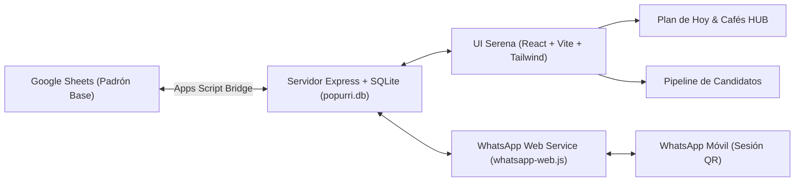
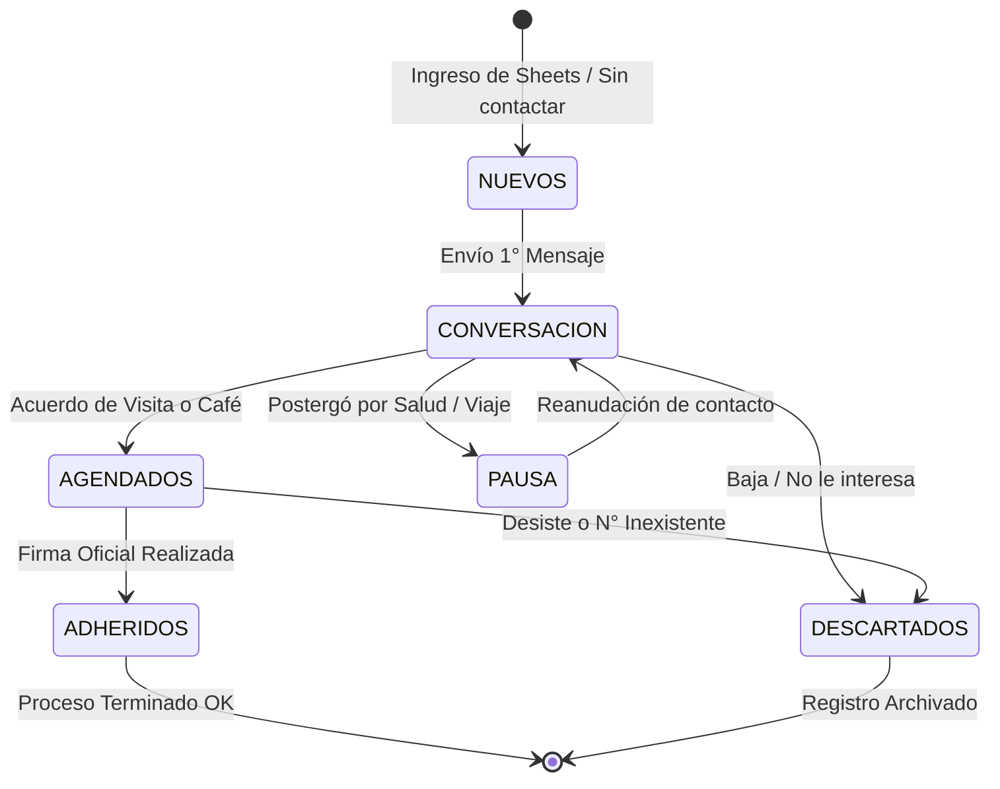
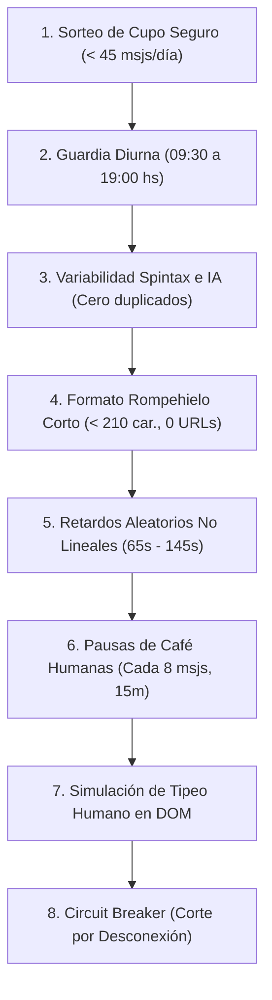

# Popurrí CABA · Sistema de Gestión Territorial, Campaña y Automatización WhatsApp

> **Campaña:** Candidatura de César Rincón (*Regeneración* / *Hacemos Popurrí*)  
> **Ámbito:** Ciudad Autónoma de Buenos Aires (CABA) — Validación, Adhesiones y Avales Electorales  
> **Versión Actual:** 2.0 (Arquitectura Modular, SQLite Nativo, WhatsApp Web.js y UI Serena)  
> **Estado de Calidad:** 28/28 Tests de Dominio Pasados (100%) · TypeScript Strict · 0 Vulnerabilidades

---

## Índice General

1. [Visión y Propósito del Sistema](#1-visión-y-propósito-del-sistema)
2. [Arquitectura Tecnológica Integral](#2-arquitectura-tecnológica-integral)
3. [Flujo de Trabajo y Ciclo de Vida del Candidato (10 Macro-Etapas)](#3-flujo-de-trabajo-y-ciclo-de-vida-del-candidato-10-macro-etapas)
4. [Lógica de Negocio y Módulos de Dominio (`src/domain`)](#4-lógica-de-negocio-y-módulos-de-dominio-srcdomain)
5. [Motor de Automatización WhatsApp y 8 Capas Anti-Bloqueo](#5-motor-de-automatización-whatsapp-y-8-capas-anti-bloqueo)
6. [Persistencia y Sincronización Híbrida (SQLite + Google Sheets)](#6-persistencia-y-sincronización-híbrida-sqlite--google-sheets)
7. [Planificación Territorial, Ruteo y Catálogo de Cafés HUB](#7-planificación-territorial-ruteo-y-catálogo-de-cafés-hub)
8. [Matriz de Verificación: Los 28 Tests Automatizados](#8-matriz-de-verificación-los-28-tests-automatizados)
9. [Diseño y Componentes de Interfaz de Usuario](#9-diseño-y-componentes-de-interfaz-de-usuario)
10. [Estructura del Repositorio y Mapa de Archivos](#10-estructura-del-repositorio-y-mapa-de-archivos)

---

## 1. Visión y Propósito del Sistema

La aplicación fue concebida para profesionalizar y optimizar la logística de recolección de firmas y adhesiones de la candidatura de César Rincón en CABA. 

### Objetivos Clave:
1. **Atención 1-a-1 Humana:** Facilitar el contacto directo y cercano con cada persona sin mensajes robóticos, preservando la voz y estilo conversacional auténtico de César.
2. **Cero Baneo en WhatsApp:** Implementar un motor de envío automático que simule comportamiento humano indistinguible para los algoritmos de detección de Meta (WhatsApp).
3. **Eficiencia en Calle:** Agrupar contactos por cercanía geográfica (micro-clusters) y vincularlos a puntos de encuentro estratégicos (Cafés HUB) para maximizar firmas por hora de recorrido.
4. **Resiliencia de Datos:** Eliminar la dependencia exclusiva de archivos temporales mediante una base de datos local SQLite transaccional, con sincronización bidireccional continua hacia Google Sheets.



---

## 2. Arquitectura Tecnológica Integral

### Frontend (SPA)
- **Framework:** React 18 con TypeScript en modo estricto.
- **Herramienta de Compilación:** Vite 8.3 (builds optimizados < 800 ms).
- **Estilos:** Tailwind CSS con paleta minimalista y serena (predominio de `#F8FAFC`, blancos puros, acentos esmeralda y toques ámbar/índigo).
- **Animaciones:** `motion/react` (Motion 12) para transiciones fluidas de acordeones, modales y pills segmentados.
- **Iconografía:** `lucide-react`.

### Backend & Servicios
- **Runtime:** Node.js 24 (ES Modules nativos).
- **Servidor HTTP:** Express 4.x con middleware CORS y parsing JSON.
- **Base de Datos:** SQLite nativo (`node:sqlite`) con modo WAL (Write-Ahead Logging) en `main/data/popurri.db`.
- **Motor de WhatsApp:** `whatsapp-web.js` + Puppeteer (Chromium headless local aislado con perfil persistente en `main/data/wa_session`).
- **Generación de QR:** `qrcode` para renderizado dinámico en base64 hacia el navegador.

---

## 3. Flujo de Trabajo y Ciclo de Vida del Candidato (10 Macro-Etapas)

Cada persona registrada en la base transita por un flujo de estados claramente definido. El sistema clasifica dinámicamente a cada candidato en una de las siguientes macro-etapas:



| ID Etapa | Nombre de Etapa | Condición de Dominio | Acción Principal |
| :--- | :--- | :--- | :--- |
| `nuevos` | **1. Nuevos candidatos** | `primerContactoEnviado = false` y `estadoFlujo = SIN_CONTACTAR_1ER_MSJ` | Enviar primer mensaje rompehielo en tanda (< 45/día). |
| `conversacion` | **2. En conversación** | 1° mensaje enviado, esperando respuesta o coordinando detalles | Seguimiento a las 24h/48h o respuesta a preguntas. |
| `agendados` | **3. Encuentros agendados** | Fecha, franja horaria o punto de encuentro fijado | Incluir en Hoja de Ruta, enviar recordatorio matutino. |
| `pausa` | **4. En pausa / Postergados** | Persona viajando, enferma o que pidió postergar | Recontactar en la fecha pactada sin insistencia. |
| `adheridos` | **5. Ya adhirieron (Firmó)** | `adhirio = 'Sí'` o `estadoFlujo = YA_ADHIRIO_FIRMA_OK` | Enviar mensaje de agradecimiento y registrar aval. |
| `descartados` | **6. Descartados / Baja** | Número inexistente, rechazo explícito o fuera de CABA | Marcar como descartado en auditoría y sincronizar a Sheets. |

### Trazabilidad y Auditoría Temporal
Cualquier cambio de estado manual o automático genera un sello temporal en los comentarios del contacto:
`[Modificado el DD/MM a las HH:mm hs a "Etapa Destino"]`
Esto garantiza visibilidad total del historial de interacciones sin sobreescribir las notas territoriales de la Columna G de Google Sheets.

---

## 4. Lógica de Negocio y Módulos de Dominio (`src/domain`)

Toda la lógica de la aplicación se encuentra desacoplada en módulos temáticos con alta cohesión y cero efectos secundarios indeseados:

### A. Contactos (`src/domain/contacts/`)
- **`phoneUtils.ts`:** Normalización estricta de números telefónicos de Argentina (`normalizarTelefonoWA`):
  - Inserción correcta del código de país `549` para celulares argentinos.
  - Limpieza de prefijos locales `15`, guiones, espacios y paréntesis.
  - Tratamiento especial para prefijos de CABA (`11`) y números del interior.
- **`nameCorrection.ts`:** Limpieza ortográfica y desambiguación (`analizarYCorregirNombreCompleto`):
  - Detecta si el nombre y apellido están invertidos (ej. *"Molinari Leto Laura"* → Nombre: *"Laura"*, Apellido: *"Molinari Leto"*).
  - Capitalización adecuada y respeto de tildes en nombres comunes.
  - Detección de contactos sin nombre en Google Sheets (`FALTA_NOMBRE_Y_APELLIDO`), inyectando preguntas sutiles anti-desconfianza.
- **`contactStatus.ts`:** Inferencia automática del estado del flujo (`inferirEstadoFlujo`) a partir del análisis del comentario (Columna G), respuestas de Sheets y confirmaciones.

### B. Geografía y Territorio (`src/domain/geo/`)
- **`cabaLocations.ts`:** Diccionario de coordenadas barriales y polígonos de referencia de las 15 comunas de CABA. Auto-corrección del barrio basada en la dirección física extraída de Columna G.
- **`cafesHub.ts`:** Catálogo curado de **151 Cafés HUB** distribuidos en todos los barrios de la Capital Federal. Cada café cuenta con dirección exacta, coordenadas GPS, accesibilidad y capacidad para reuniones de firma.

### C. Ruteo y Agrupamiento (`src/domain/routing/`)
- **`clustering.ts`:** Algoritmo de micro-clusters territoriales que agrupa candidatos con distancias caminables (< 800 m) para optimizar recorridos a pie.
- **`routingEngine.ts`:** Motor de cálculo de la Hoja de Ruta (`calcularHojaDeRuta`). Determina orden de visita óptimo, tiempos de traslado según Google Maps (a pie y transporte público) y asigna el Café HUB más cercano cuando se reúnen dos o más personas.

### D. Calendario y Horarios (`src/domain/calendar/`)
- **`availability.ts` & `calendarEvents.ts`:**
  - Análisis de disponibilidad en texto libre de Columna G (`analizarFranjaHoraria`).
  - Detección y deduplicación de eventos de Google Calendar.
  - **Evitación de colisiones:** Bloquea horarios personales (ej. Terapia los miércoles 14:30-15:20) e impide asignar visitas de madrugada (< 09:30 o > 19:30).

### E. Mensajería y Tono (`src/domain/messaging/`)
- **`greetingsAndTone.ts` & `messageTemplates.ts`:**
  - Reglas de saludo según hora del día (Mañana / Tarde).
  - Variabilidad de Spintax en frases de apertura, cuerpo y cierre.
  - Tono cálido, respetuoso y auténtico sin muletillas falsas ni excesos protocolares.

---

## 5. Motor de Automatización WhatsApp y 8 Capas Anti-Bloqueo

Para evitar sanciones o bloqueos en la cuenta de WhatsApp por parte de Meta, el sistema opera con el framework **Stealth v2.0**:



### Las 8 Capas de Protección:
1. **Cupo Máximo Diario Restringido (`sortearCupoSeguroAntiBloqueo`):**
   - Nunca supera los 44 mensajes diarios en frío.
   - Cuenta con curva de calentamiento (*Warm-up*):
     - *Día 1:* 7 a 10 mensajes.
     - *Día 2:* 11 a 15 mensajes.
     - *Día 3:* 18 a 25 mensajes.
     - *Día 4:* 26 a 35 mensajes.
     - *Día 5+ (Maduro):* 28 a 44 mensajes aleatorios.
2. **Ventana Horaria Diurna Estricta:**
   - Inicio automático no antes de las 09:30 hs.
   - Corte nocturno preventivo a las 19:00 hs.
3. **Variabilidad Polimórfica (Spintax + Gemini IA):**
   - Cada mensaje cuenta con una estructura diferente.
   - No se envían dos textos idénticos consecutivos.
4. **Modo Rompehielo Corto:**
   - Mensajes breves (< 210 caracteres).
   - Sin enlaces (URLs externas), que disparan alertas de spam en cuentas que no se tienen agendadas mutuamente.
   - Pregunta final abierta para estimular una respuesta humana orgánica.
5. **Intervalos Aleatorios Gaussianos:**
   - Retardo entre envíos configurado entre 65 y 145 segundos.
6. **Pausas Humanas de Café (*Coffee Breaks*):**
   - Cada 8 mensajes enviados, el despachador pausa deliberadamente entre 12 y 22 minutos, simulando que el operador se tomó un café o atendió otra llamada.
7. **Simulación de Escritura en el Navegador (`sendStateTyping`):**
   - Puppeteer envía el estado `"escribiendo..."` durante 2 a 5.5 segundos en la ventana del chat antes de despachar el paquete de texto.
8. **Disyuntor de Seguridad (*Circuit Breaker*):**
   - Si la sesión de WhatsApp Web se cierra, el WebSocket se corta o el teléfono reporta desvinculación, la cola se frena en seco de inmediato para evitar envíos huérfanos.

---

## 6. Persistencia y Sincronización Híbrida (SQLite + Google Sheets)

El backend implementa un patrón repositorio sobre SQLite nativo (`main/server/db.ts`):

```
main/data/
├── popurri.db          # Base de datos SQLite (Contactos, Envíos, Eventos, Config)
├── popurri.db-wal      # Write-Ahead Log para transacciones concurrentes
└── wa_session/         # Perfil local de Chromium autenticado con WhatsApp
```

### Tablas Principales:
- `contacts`: Almacena el padrón completo de contactos (ID, nombre, barrio, teléfono, rsp, adhirió, comentario, estado de flujo, marcas de tiempo).
- `control_envios`: Auditoría histórica de cada mensaje enviado por WhatsApp (éxito, teléfono, contenido, fecha y estado Sheets).
- `calendar_events`: Eventos locales y sincronizados para la hoja de ruta.
- `app_settings`: Claves y configuración de campaña persistente.

### Integración con Google Sheets (`google_apps_script_bridge.js`):
- Mapeo estricto de columnas (Col A: ID, Col B: Nombre, Col C: Barrio, Col D: Teléfono, Col E: RSP, Col F: Adhirió, Col G: Comentario, Col H: Estado Flujo).
- Garantía de no sobrescritura de notas territoriales.
- Actualización de estatus en tiempo real tras envíos exitosos o bajas por número inexistente.

---

## 7. Planificación Territorial, Ruteo y Catálogo de Cafés HUB

El módulo **Plan de Hoy & Rutas** (`PlanHoyModernView.tsx`) organiza la labor de campo:
1. **Detección de Contactos Prioritarios:** Filtra quiénes confirmaron disponibilidad para el día en curso.
2. **Circuitos Geográficos:** Agrupa las paradas por proximidad barrial (ej. Circuito Palermo - Colegiales).
3. **Asignación de Cafés HUB:** Si varios contactos residen en un radio cercano, el sistema sugiere un Café HUB del catálogo para convocarlos a una firma compartida.
4. **Mensajería Territorial de Parada:** Botones contextuales de 1 clic para enviar avisos:
   - *"🌅 Recordatorio matutino antes de salir"*
   - *"🚗 En camino (tiempo estimado)"*
   - *"🔔 En la puerta (2 minutos)"*
   - *"☕ Ya en Café HUB esperándote"*
   - *"🗓️ Disculpas / Reprogramación"*

---

## 8. Matriz de Verificación: Los 28 Tests Automatizados

En `main/src/utils/logic.test.ts` se ejecutan **28 pruebas unitarias y de integración** que validan la solidez del sistema ante cualquier refactor:

| # | Test | Aspecto Evaluado |
| :- | :--- | :--- |
| 1 | `normalizarTelefonoWA` | Formateo correcto de números argentinos (+549, 15, prefijos CABA). |
| 2 | `analizarYCorregirNombreCompleto` | Inversión Nombre/Apellido, tildes y mayúsculas. |
| 3 | `extraerCalleOCruce` | Limpieza de Columna G ignorando anotaciones de cantidad (X2/X3). |
| 4 | `analizarFranjaHoraria` | Clasificación correcta de ventanas horarias diurnas y nocturnas. |
| 5 | `procesarContacto` | Distinción entre Nuevos, Sin Respuesta y Cambió de Chip. |
| 6 | `construirMicroClusters` | Ruteo territorial excluyendo contactos sin dirección en Col G. |
| 7 | `auto-corrección de barrio` | Detección automática del barrio real según la dirección física. |
| 8 | `contactos desde #167` | Marcado como pendientes de 1er contacto para nuevos ingresos. |
| 9 | `teléfonos sin nombre` | Asignación de estado `FALTA_NOMBRE_Y_APELLIDO` y mensaje sutil. |
| 10 | `inferirEstadoFlujo` | Reconocimiento de estados por disponibilidad, encuentro y firma. |
| 11 | `parsearTSVoCSVContactos` | Detección estricta de Col B como Nombre (nunca confunde con Barrio). |
| 12 | `automatizador 7 capas` | Cupo < 45, Spintax, Opt-Out amigable, sin URLs y pausas de café. |
| 13 | `Catálogo Cafés HUB` | Mapeo de los 151 cafés a circuitos y barrios de CABA. |
| 14 | `Stealth v2.0` | Navegación SPA sin page.goto en bucle, rompehielo corto y filtro +54. |
| 15 | `deduplicarEventosCalendar` | Limpieza de claves duplicadas en eventos recurrentes de Calendar. |
| 16 | `generarCorteEstrategicoLocal` | Cronograma diurno coherente sin desborde a la madrugada. |
| 17 | `analizarDisponibilidadColumnaG` | Coordinación de franjas amplias sin falsas cancelaciones. |
| 18 | `correspondencia Café HUB` | Correspondencia 100% de café entre Agenda, Lista y Mensaje WA. |
| 19 | `contactos pautados para HOY` | Inclusión obligatoria en agenda del día de visitas pautadas. |
| 20 | `aviso de reprogramación` | Alerta de superposición con citas fijadas previamente. |
| 21 | `asegurarIdsUnicosContactos` | Prevención de IDs duplicados ante filas vacías de Sheets. |
| 22 | `detectar visitas vencidas` | Recálculo de agenda incorporando citas personales fijas (ej. Terapia). |
| 23 | `Chile 1408 y tono de César` | Presentación sólo en 1er contacto y sin respuesta, tono natural sin muletillas. |
| 24 | `persistencia de cambios` | Conservación de estados y envíos al recargar la aplicación. |
| 25 | `asunción de responsabilidad` | Mensajes de reprogramación respetuosos sin culpar al candidato. |
| 26 | `Calendar eventos ficticios` | Filtrado de citas pasadas y persistencia de confirmaciones. |
| 27 | `tiempos de viaje Google Maps` | Coherencia de URLs de Maps y estimaciones a pie / colectivo. |
| 28 | `Validador Anti-Pelones` | Regla de saludo diurno, panel de tareas y cierre con Google Forms. |

---

## 9. Diseño y Componentes de Interfaz de Usuario

La interfaz fue reconstruida bajo una filosofía serena, luminosa y altamente intuitiva:

### Componentes Centrales:
1. **`ModernNavbar.tsx`:**
   - Ancho expandido a `max-w-[1600px]`.
   - Botones con `whitespace-nowrap shrink-0` para evitar quiebres de línea.
   - Pestañas concisas con badges en vivo: `Candidatos (246)`, `Mapa & Cafés`, `Plan de Hoy`, `WhatsApp Web`, `Configuración`.
   - Indicador de estado de WhatsApp Web con pulso animado (Verde = Conectado, Ámbar = QR listo, Gris = Desconectado).

2. **`CandidatePipelineView.tsx`:**
   - **Acordeones Retraíbles por Defecto:** Al ingresar, todas las etapas se encuentran plegadas para una lectura ordenada y descansada.
   - Despliegue en 1 clic con animaciones suaves de altura (`motion/react`).
   - Sincronización con tarjetas métricas KPI: tocar una tarjeta superior abre automáticamente esa etapa y la resalta.
   - Botón general de *"Plegar todas" / "Desplegar todas"*.
   - **Tarjetas Horizontales Amplias (`CandidateCard.tsx`):**
     - Nombre completo sin truncar.
     - Teléfono con botón de copia rápida al portapapeles en 1 clic.
     - Contenedor de notas territoriales (Columna G) destacado.
     - Dropdown de cambio rápido de etapa con registro de auditoría.
     - Botón directo `"✓ Firmó"` para cerrar adhesiones en un clic.

3. **`AutoFirstMessageModal.tsx`:**
   - Reemplazo total de la antigua interfaz oscura por un modal blanco luminoso y elegante.
   - Selector segmentado de etapa de campaña.
   - 4 Pestañas: *Ajustes Anti-Bloqueo*, *Cola de Contactos*, *WhatsApp Web Directo* y *Auditoría*.
   - Previsualización de cola en tarjetas individuales con conteo de tipeo simulado, variabilidad IA y divisores visuales de pausa de café.

4. **`WhatsAppWebAutomationPanel.tsx`:**
   - Visualización directa del Código QR para emparejamiento con el celular.
   - Consola de logs en vivo con marcas de tiempo.
   - Barra de progreso interactiva con contador regresivo de segundos entre mensajes.
   - Botones de control de ejecución: Iniciar, Pausar, Reanudar y Abortar.

---

## 10. Estructura del Repositorio y Mapa de Archivos

```
aplicacionCesar/
├── DOCUMENTACION_COMPLETA_SISTEMA.md    # Este documento maestro
├── main/
│   ├── .env.example                     # Plantilla segura de variables de entorno
│   ├── .gitignore                       # Ignora sesiones Chromium, sqlite db y temporales
│   ├── package.json                     # Dependencias (React, Express, whatsapp-web.js, Vite)
│   ├── server.ts                        # Servidor HTTP API Express principal
│   ├── server/
│   │   ├── db.ts                        # Conexión y esquemas nativos SQLite (popurri.db)
│   │   ├── contactRoutes.ts             # Endpoints REST para candidatos y cambios de estado
│   │   ├── routes/
│   │   │   └── whatsappRoutes.ts        # Endpoints de estado, QR, envío y cola de WhatsApp
│   │   ├── services/
│   │   │   └── whatsappService.ts       # Servicio singleton de WhatsApp Web.js
│   │   └── repositories/
│   │       ├── contactRepository.ts     # CRUD de contactos en SQLite
│   │       ├── controlEnvioRepository.ts# Registro de envíos para auditoría
│   │       ├── calendarRepository.ts    # Repositorio de eventos Calendar
│   │       └── settingsRepository.ts    # Configuración persistente
│   ├── src/
│   │   ├── App.tsx                      # Componente raíz con navegación desacoplada
│   │   ├── types.ts                     # Definiciones de tipos TypeScript de todo el sistema
│   │   ├── components/
│   │   │   ├── layout/ModernNavbar.tsx  # Header espacioso y barra de pestañas
│   │   │   ├── pipeline/                # Vistas del Pipeline de Candidatos
│   │   │   │   ├── CandidatePipelineView.tsx # Vista de carriles horizontales retraíbles
│   │   │   │   ├── CandidateCard.tsx         # Tarjeta horizontal espaciosa con copia rápida
│   │   │   │   └── CandidateDrawer.tsx       # Inspector lateral con auditoría temporal
│   │   │   ├── corte/PlanHoyModernView.tsx   # Plan del Día, Circuitos y Cafés HUB
│   │   │   ├── InteractiveMapPanel.tsx  # Mapa Google Maps con micro-clusters
│   │   │   ├── WhatsAppWebAutomationPanel.tsx # Monitor de QR y ejecución de cola
│   │   │   ├── AutoFirstMessageModal.tsx# Modal sereno de configuración de campaña
│   │   │   └── config/ModernSettingsView.tsx # Ajustes de sincronización Sheets y perfil
│   │   ├── domain/                      # Capa de Dominio Desacoplada
│   │   │   ├── contacts/                # Estados, normalización y corrección de nombres
│   │   │   ├── geo/                     # Coordenadas y catálogo de Cafés HUB
│   │   │   ├── routing/                 # Agrupamiento territorial y motor de ruta
│   │   │   ├── calendar/                # Disponibilidad y colisiones de agenda
│   │   │   ├── messaging/               # Plantillas, Spintax y tono conversacional
│   │   │   ├── automation/              # Límites anti-ban y generadores de tanda
│   │   │   └── sync/                    # Parsers de Sheets y fusión de datos
│   │   └── utils/
│   │       ├── logic.ts                 # Fachada central compatible con el sistema
│   │       └── logic.test.ts            # Suite con los 28 tests de verificación
│   └── data/                            # Directorio local de datos (ignorado en git)
│       ├── popurri.db                   # Base de datos SQLite
│       └── wa_session/                  # Sesión autenticada de WhatsApp
```

---

## Conclusión

El sistema reúne robustez backend, rigor algorítmico electoral, resguardo total anti-bloqueo y una interfaz moderna y descansada. Todo cambio futuro en reglas de negocio o interfaz puede validarse instantáneamente ejecutando:

```bash
# 1. Comprobación de tipos TypeScript
npm run lint --prefix main

# 2. Verificación de los 28 invariantes de dominio
npx tsx main/src/utils/logic.test.ts

# 3. Compilación de producción
npm run build --prefix main
```
